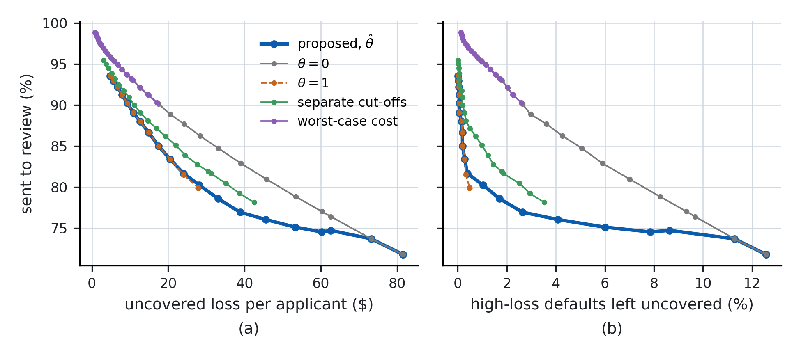
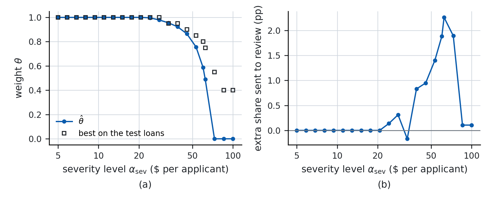

# Severity-Aware Conformal Prediction

**How to Weight Probability and Loss**

Code for a review rule that controls two risks at once. A case is sent to human review unless it is safe to approve. The rule bounds the share of adverse cases that pass unreviewed (coverage) and the expected loss they cause (severity), and sends as few cases to review as possible.

The paper is in [`paper/severity_aware_conformal_prediction.pdf`](paper/severity_aware_conformal_prediction.pdf), with a one-page summary in [`paper/summary.pdf`](paper/summary.pdf).

## Main results

- **Optimal rule.** With the default probability $p$ and the expected loss given default $c$ known, the optimal rule thresholds the blended score $h_\theta = (1-\theta)\,p + \theta\,pc/B$. The optimal weight $\theta^*$ is unique, equals one when only severity binds and zero when only coverage binds, and decreases strictly in the severity level in between.
- **Estimation with exact guarantees.** The weight is estimated without labels from a plug-in dual linear program. Conformal risk control on the blended score keeps both guarantees in finite samples for any estimated weight. The excess share sent to review vanishes as the samples grow and the estimates of $p$ and $c$ improve.
- **LendingClub loan dataset.** At a severity level of \$60 per applicant and a coverage level of 10%, the method sends 74.5% of applicants to review, against 77.0% to 93.3% for four other rules that meet both levels.

<p align="center">
  <br>
  <em>Share sent to review against the uncovered loss and the high-loss defaults left uncovered, 2015 loans.</em>
</p>

<p align="center">
  <br>
  <em>The estimated weight across severity levels and its gap to the best weight on the test loans.</em>
</p>

## Repository

```
src/
  simulation.py            simulation study (Sections 3 and 5, Appendix C)
  lendingclub.py           LendingClub experiments (Section 6, Discussion)
  prepare_lendingclub.py   filter the raw LendingClub file (Appendix D)
  train_models.py          fit p_hat and c_hat with LightGBM (Appendix D)
  lc_data.py, splits.py    constants and sample splits
paper/                     the paper and its one-page summary (PDF)
results/
  simulation/              figures and saved data of the simulation study
  lendingclub/             figures and summary tables of Section 6
REPRODUCE.md               one command per figure, table and number of the paper
```

## Setup

```
pip install -r requirements.txt
```

The LendingClub loan dataset is not redistributed here. Download `accepted_2007_to_2018Q4.csv` from the [Lending Club dataset on Kaggle](https://www.kaggle.com/datasets/wordsforthewise/lending-club) and place it in `data/raw/`. Then

```
mkdir -p data/raw data/processed
python src/prepare_lendingclub.py --raw data/raw/accepted_2007_to_2018Q4.csv
python src/train_models.py
python src/lendingclub.py run --n 100
python src/simulation.py fig1a
```

[`REPRODUCE.md`](REPRODUCE.md) maps every figure, table and number of the paper to its command.

## References

Papers cited in the accompanying paper, with links to the publisher or arXiv version.

| # | Reference | Link |
|---|---|---|
| 1 | Andrews (1999). Estimation when a parameter is on a boundary. *Econometrica* 67(6). | [doi:10.1111/1468-0262.00082](https://doi.org/10.1111/1468-0262.00082) |
| 2 | Angelopoulos, Bates, Fisch, Lei, Schuster (2024). Conformal risk control. *ICLR*. | [arXiv:2208.02814](https://arxiv.org/abs/2208.02814) |
| 3 | Angelopoulos, Bates, Candès, Jordan, Lei (2025). Learn then test. *Annals of Applied Statistics* 19(2). | [doi:10.1214/24-AOAS1998](https://doi.org/10.1214/24-AOAS1998), [arXiv:2110.01052](https://arxiv.org/abs/2110.01052) |
| 4 | Bai, Jin (2026). Conformal selective prediction with general risk control. | [arXiv:2603.24704](https://arxiv.org/abs/2603.24704) |
| 5 | Basel Committee on Banking Supervision (2006). International convergence of capital measurement and capital standards (Basel II). | [bis.org/publ/bcbs128](https://www.bis.org/publ/bcbs128.htm) |
| 6 | Boyd, Vandenberghe (2004). *Convex Optimization*. | [stanford.edu/~boyd/cvxbook](https://web.stanford.edu/~boyd/cvxbook/) |
| 7 | Charusaie, Samadi (2024). A unifying post-processing framework for multi-objective learn-to-defer problems. *NeurIPS*. | [arXiv:2407.12710](https://arxiv.org/abs/2407.12710) |
| 8 | Chzhen, Denis, Hebiri, Oneto, Pontil (2019). Leveraging labeled and unlabeled data for consistent fair binary classification. *NeurIPS*. | [arXiv:1906.05082](https://arxiv.org/abs/1906.05082) |
| 9 | Hjort, Pollard (1993). Asymptotics for minimisers of convex processes. | [arXiv:1107.3806](https://arxiv.org/abs/1107.3806) |
| 10 | Joshi, Sun, Hassani, Dobriban (2025). MultiRisk. Multiple risk control via iterative score thresholding. | [arXiv:2512.24587](https://arxiv.org/abs/2512.24587) |
| 11 | Lehmann, Romano (2005). *Testing Statistical Hypotheses*, third edition. | [doi:10.1007/0-387-27605-X](https://doi.org/10.1007/0-387-27605-X) |
| 12 | Massart (1990). The tight constant in the Dvoretzky–Kiefer–Wolfowitz inequality. *Annals of Probability* 18(3). | [doi:10.1214/aop/1176990746](https://doi.org/10.1214/aop/1176990746) |
| 13 | Sadinle, Lei, Wasserman (2019). Least ambiguous set-valued classifiers with bounded error levels. *JASA* 114(525). | [doi:10.1080/01621459.2017.1395341](https://doi.org/10.1080/01621459.2017.1395341), [arXiv:1609.00451](https://arxiv.org/abs/1609.00451) |
| 14 | Self, Liang (1987). Asymptotic properties of maximum likelihood estimators and likelihood ratio tests under nonstandard conditions. *JASA* 82(398). | [doi:10.1080/01621459.1987.10478472](https://doi.org/10.1080/01621459.1987.10478472) |
| 15 | Serrano-Cinca, Gutiérrez-Nieto (2016). The use of profit scoring as an alternative to credit scoring systems in P2P lending. *Decision Support Systems* 89. | [doi:10.1016/j.dss.2016.06.014](https://doi.org/10.1016/j.dss.2016.06.014) |
| 16 | Shen, Su, Kong, Wu (2026). Conformal non-coverage risk control (CNCRC). *ICML 2026 Workshop*. | [icml.cc/virtual/2026/74503](https://icml.cc/virtual/2026/74503) |
| 17 | Singh, Srikantha, Lakhanpal (2026). Cost-sensitive conformal prediction and human-in-the-loop abstention. | [arXiv:2607.27143](https://arxiv.org/abs/2607.27143) |
| 18 | Tian, Feng (2025). Neyman–Pearson multi-class classification via cost-sensitive learning. *JASA* 120(550). | [arXiv:2111.04597](https://arxiv.org/abs/2111.04597) |
| 19 | Tibshirani, Barber, Candès, Ramdas (2019). Conformal prediction under covariate shift. *NeurIPS*. | [arXiv:1904.06019](https://arxiv.org/abs/1904.06019) |
| 20 | Vovk, Gammerman, Shafer (2005). *Algorithmic Learning in a Random World*. | [doi:10.1007/b106715](https://doi.org/10.1007/b106715) |

## Author

Sung In (David) Cho
